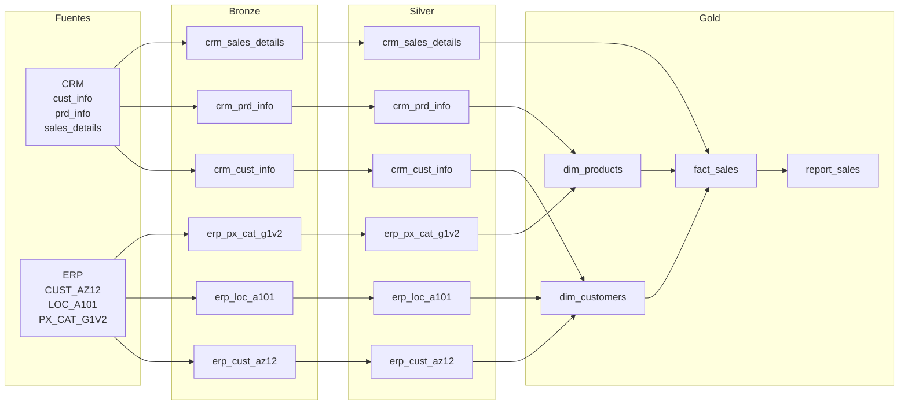

# Flujo de datos

| Capa | Proceso | Carga |
|---|---|---|
| Bronze | `bronze.load_bronze` – BULK INSERT desde CSV, sin cambios | Truncate & Insert |
| Silver | `silver.load_silver` – limpieza y estandarización | Truncate & Insert |
| Gold | Vistas – integración en modelo estrella | No aplica |
